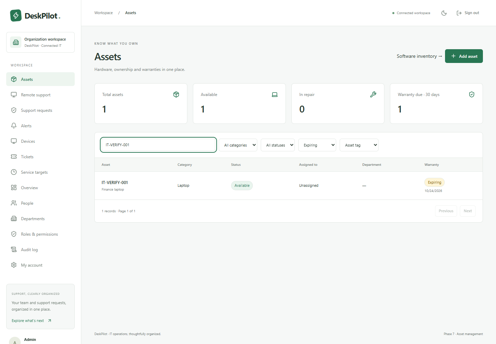

# DeskPilot

**AI-Powered IT Helpdesk, Remote Support & Endpoint Management**

DeskPilot is being built as a single-organization IT operations platform. **Phase 9 adds optional Groq/Gemini ticket analysis and a searchable knowledge base.** Signed webhooks, retries and an in-app inbox are also implemented. Hardware assets, employee assignments, warranty tracking and real Windows software inventory are implemented. Tickets, device monitoring, diagnostics and customer approval requests are also implemented. Live RustDesk control remains disabled pending a verified engine integration and two-device acceptance testing. See [asset architecture](docs/architecture/phase-7.md) and [remote-support status](docs/remote-support/README.md).

## Current application

- Laravel 13 API, PHP 8.4, PostgreSQL, Redis sessions/cache/queues, Docker Compose and Nginx.
- React 19, strict TypeScript, Vite, Tailwind, local shadcn/Radix UI components, React Router, TanStack Query, Zustand, React Hook Form and Zod.
- Email/password login, CSRF protection, session rotation, logout, verification emails and password reset.
- Six permission-based role templates; API authorization, privileged-account protection and last-administrator safeguards.
- Persistent user and department management with search, filters, sorting, pagination, column visibility, and atomic bulk activation/deactivation.
- Audit records for authentication and account/department changes. Deactivation permanently revokes existing sessions, even if the account is later re-enabled.
- Ticket creation, assignment, public replies, internal notes, private screenshot/text attachments, resolution, closing and reopening.
- Search, queues, filters, tags, pagination, atomic bulk priority updates, SLA targets and immutable ticket history.
- Database-backed helpdesk dashboard, responsive navigation, light/dark modes, loading, empty and error states.

- Native .NET Windows agent with DPAPI-protected signing keys, expiring enrollment grants, replay-resistant reports, heartbeat, real hardware/network inventory and credential revocation.
- Device inventory/detail screens with online/offline/pending/revoked states, actual metrics, and responsive light/dark layouts.
- Diagnostics with signed dispatch, authorization rechecks, execution leases, bounded runtime/output, encrypted retry storage, cancellation and audited result history.

- Hardware register with assignment/return history, warranty filters, device linking and audit records.
- Signed Windows software reports with search, publisher/device filters and visible coverage limits.

## Screenshots

Actual browser screenshots using a disposable development database:



[Asset details](docs/screenshots/asset-detail.png) · [Assets dark mode](docs/screenshots/assets-dark.png) · [Mobile assets](docs/screenshots/assets-mobile.png) · [Software inventory](docs/screenshots/software-inventory.png)

[Monitoring](docs/screenshots/monitoring.png)

[Monitoring dark mode](docs/screenshots/monitoring-dark.png) · [Mobile monitoring](docs/screenshots/monitoring-mobile.png) · [Automatic incident](docs/screenshots/monitoring-incident.png)

[Diagnostics dark mode](docs/screenshots/diagnostics-dark.png) · [Mobile diagnostics](docs/screenshots/diagnostics-mobile.png)

[Devices](docs/screenshots/devices.png) · [Device dark mode](docs/screenshots/device-dark.png) · [Mobile device](docs/screenshots/device-mobile.png) · [Ticket detail](docs/screenshots/ticket-detail.png)

[Ticket queue](docs/screenshots/tickets.png) · [Dashboard](docs/screenshots/helpdesk-dashboard.png) · [Mobile ticket](docs/screenshots/ticket-mobile.png)

[Login](docs/screenshots/login.png) · [People](docs/screenshots/people.png) · [Dark mode](docs/screenshots/people-dark.png) · [Mobile](docs/screenshots/mobile.png)

## Start locally

With a working Docker Linux engine:

```powershell
node scripts/setup-env.mjs
docker compose up -d --build
docker compose exec api php artisan migrate --seed --force
docker compose exec api php artisan deskpilot:create-admin
```

Open **http://localhost:8080**. The last command prompts for your administrator credentials; no default password is shipped. Development email is available in Mailpit at **http://localhost:8025**.

For native frontend/backend development, run `npm ci` and `composer install --working-dir=apps/server`, configure `apps/server/.env` from the example, then use `npm start` and `composer run dev --working-dir=apps/server` in separate terminals. PostgreSQL, Redis, the mail service, and a queue worker must also be running. Full instructions: [local setup and deployment](docs/deployment/README.md).

The root `dist/`, `server.mjs`, and `smoke-check.cjs` preserve the original static design prototype. `npm run preview:legacy` serves it; it is **not** the Laravel application. The earlier static Sites manifest is not suitable for deploying this PHP application.

## Architecture and design deliverables

| Document | Contents |
| --- | --- |
| [System architecture](docs/architecture/README.md) | Components, repository structure, boundaries and realtime design |
| [Phase 2 design](docs/architecture/phase-2.md) | Ticket schema, lifecycle, access rules, SLA and attachment limits |
| [Database design](docs/architecture/database.md) | Phase 1 ERD/schema and reviewed future module relationships |
| [Authentication and RBAC](docs/security/authentication.md) | Cookies, CSRF, verification, password broker, permissions and auditing |
| [API reference](docs/api/README.md) | Versioned endpoints, validation and access rules |
| [Windows agent setup](docs/agent/communication.md) | Install, enroll, run, revoke and inspect the real Windows agent |
| [Phase 5 design](docs/architecture/phase-5.md) | Health rules, freshness, alert lifecycle, cooldown and automatic incidents |
| [Phase 4 design](docs/architecture/phase-4.md) | Approved diagnostic catalog, execution lifecycle and limits |
| [Phase 3 design](docs/architecture/phase-3.md) | Signed agent protocol, normalized inventory, availability and validation |
| [Remote support](docs/remote-support/README.md) | RustDesk, customer consent, transport boundaries and verification gates |
| [Automation](docs/automation.md) | Current queues and planned signed webhooks/n8n integration |
| [Roadmap](docs/architecture/roadmap.md) | Ten phases and acceptance gates |
| [Verification](docs/verification.md) | Checks performed and remaining environment limits |

## Testing

```powershell
npm run typecheck
npm run lint
npm test
npm run build
```

From `apps/server`, run `php artisan test` against the dedicated `deskpilot_test` PostgreSQL database and `php vendor/bin/pint --test`. Never use a development/production database for tests. Browser tests use `node scripts/browser-check.mjs` and the dedicated `deskpilot_browser_test` database; the harness recreates **that test schema only**, generates ephemeral passwords in memory, and captures screenshots.

## Environment variables

Root `.env` supplies Compose's APP_KEY, DB_PASSWORD, APP_URL and FRONTEND_URL. The setup script generates secrets without printing them. Server `.env.example` describes PostgreSQL, Redis, sessions and SMTP. Never commit `.env`, private keys, database files or real credentials. Development demo accounts require an explicitly supplied `DESKPILOT_DEMO_PASSWORD` and refuse production execution.

## Windows agent and remote support

The native C#/.NET agent implements enrollment, inventory and seven approved read-only diagnostics. RustDesk with customer approval is the selected Phase 6 engine; remote sessions are not available yet. That phase requires enforced consent, real connection/termination events and testing on customer and technician computers.

## Security and production status

The application is under development, not production-certified. MFA is planned. Remote unattended access is disabled by design. Device APIs require signed identity or authorized browser sessions. Arbitrary shell execution is not exposed. See the security and deployment documents for TLS, secret injection, SMTP, backups, worker supervision and production hardening requirements. The complete MVP is not done until the real ticket → device diagnostic → consent → remote support scenario passes.

## License

A project-wide distribution license has not been selected. Third-party dependencies retain their respective licenses; the generated Laravel framework scaffolding carries its upstream MIT license metadata. Choose an explicit project license before public distribution.


## Windows agent

The solution is in `apps/agent/DeskPilot.Agent.slnx`. Self-contained Windows x64 binaries are produced in `apps/agent/publish/service` and `apps/agent/publish/tray`; copy the complete directories. [Setup instructions](docs/agent/communication.md) cover installation and enrollment. The agent was verified against this real Windows computer using an isolated local database. No persistent service was installed during testing. Authenticode signing, installed-service/reboot behavior and production TLS validation remain deployment steps.

Run `node scripts/agent-browser-check.mjs` to repeat the real Windows agent/browser test after building the agent and starting PostgreSQL. It uses only `deskpilot_browser_test`, temporary enrollment credentials and a temporary protected key store.

Run `node scripts/diagnostics-browser-check.mjs` to verify all seven real diagnostics and their UI. Run browser harnesses separately because they share the disposable browser database.

## Device health monitoring

Open **Alerts** for fleet health, automatic incident links and configurable rules; individual device pages show health coverage. The Laravel scheduler must run continuously (`php artisan schedule:work` for local development). Defaults: disk >85% warning / >95% critical, sustained CPU/RAM >90%, and missing heartbeat >180 seconds. Agent 0.5.0 refreshes inventory every 15 minutes. See [Phase 5 design](docs/architecture/phase-5.md) for freshness, recovery and deduplication.

Run `node scripts/monitoring-browser-check.mjs` to repeat actual disk/offline/recovery verification in the disposable browser database.

## Phase 8 — Automation

The Automation screen configures signed webhooks, delivery history/retries and in-app notification rules. The Inbox shows updates allowed by each user’s current access. Run the scheduler and queue worker to send deliveries. New receivers start disabled. See [architecture and operations](docs/architecture/phase-8.md) and [n8n setup](infrastructure/n8n/README.md). Live n8n deployment needs receiver configuration; the included workflow is inactive and validation-only. Phase 6 live RustDesk control remains integration-pending.

## Phase 9 — AI assistance and knowledge

Support users can review context before requesting a ticket summary, suggested classification, diagnostic interpretation and troubleshooting recommendations. Published knowledge articles supply references. AI is disabled by default; no ticket changes or device commands are executed by AI. [Architecture](docs/architecture/phase-9.md) · [Groq/Gemini setup](docs/deployment/ai.md). Live provider validation requires your server-side key and a supported model.
