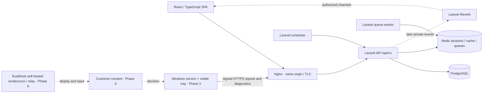

# DeskPilot architecture

Status: Phase 5 implementation. Single organization per deployment. The original static design remains in the root `dist/` directory as a visual reference; the application lives in `apps/`. Foundation, helpdesk, Windows enrollment/inventory, approved diagnostics and monitoring are implemented. Phases 6–10 remain planned.

## System



Laravel owns identity, permissions, workflow and persistence. Thin controllers delegate transactional writes to services. Eloquent handles normal queries; no generic repository layer. PostgreSQL is the application database in development, tests and production. Node is frontend build tooling only. Redis is infrastructure, not a durable record store. A failed queue must not erase committed records.

## Repository

```text
apps/
  web/src/{components,features,lib,stores}
  server/{app,bootstrap,config,database,routes,tests}
  agent/                  # .NET worker, infrastructure, protocol, tray and checks
infrastructure/docker/    # PHP, Nginx, frontend images
docs/
  architecture/           # design, ERD, schema, roadmap
  api/                    # versioned contracts
  security/               # auth and RBAC
  agent/                  # enrollment and local identity design
  remote-support/         # consent and transport boundary
  deployment/             # local and production setup
docker-compose.yml
```

## Data ownership and constraints

All public entity identifiers are UUIDs. Internal join rows may use composite primary keys. Role and permission slugs are unique and immutable through Phase 1 APIs. Users are disabled rather than deleted; audit references remain intact. Department deletion is blocked while user, device, enrollment or ticket records reference it. Audit metadata is intentionally JSON because individual event payloads differ; it never contains passwords, session cookies, tokens or complete request bodies.

Phase 1 migrations create only users, departments, RBAC joins, password reset tokens, audit logs and Laravel queue infrastructure. Phase 2 adds ticket/SLA/comment/attachment/history tables. Phase 3 adds enrolled devices, public credentials, grants, replay nonces and normalized inventory. Phase 4 adds `device_commands` for diagnostic requests, leases and results. Phase 5 adds alert rules, device alerts, evaluation state and scheduler freshness. Remaining module tables are conceptual until their phase begins.

## Realtime design

The current UI uses mutation-driven TanStack Query invalidation and 30-second refresh for ticket/device views, including refreshing the current user's permissions. Later phases add Laravel Reverb private channels authenticated through the same session: `users.{uuid}`, authorized ticket channels, and permission-scoped device channels. Events dispatch after transaction commit, contain resource IDs and version timestamps, and prompt API refetches. A WebSocket is not an authorization grant. Channel authorization and every mutation recheck current permissions. Reconnect uses bounded exponential backoff plus an API resync. Future diagnostics agents use bounded command polling initially and a wake-up signal later; a wake-up never contains credentials or executable shell text.

## Architectural decisions

- Adopt Laravel 13 on PHP 8.4, React with strict TypeScript, Vite, Tailwind and shadcn-style local UI components; lock exact installed dependencies.
- Cookie-based Laravel session authentication for the first-party SPA. No browser localStorage access tokens.
- Invite-only user creation through administrators. Verification email and password reset links are handled by Laravel notifications and the password broker.
- Six seeded roles map to explicit permission rows. Services and routes check permissions, not display names. No unconditional super-admin bypass.
- Users with account-management access cannot grant authority they do not possess; privileged role grants require `roles.manage`.
- Role/activation updates preserve at least one active, verified holder of `roles.manage` and `users.manage`.
- Implement MFA enrollment in a later hardening increment; reserve a recent-authentication boundary for high-risk actions. Do not claim MFA is enabled.
- Do not deploy the Laravel server to the old static Sites manifest. It requires PHP, PostgreSQL, Redis and a persistent worker.

## Sources reviewed

- [Laravel releases](https://laravel.com/docs/13.x/releases)
- [Laravel authentication](https://laravel.com/docs/13.x/authentication)
- [Laravel Sanctum SPA authentication](https://laravel.com/docs/13.x/sanctum#spa-authentication)
- [PostgreSQL support policy](https://www.postgresql.org/support/versioning/)
- [React versions](https://react.dev/versions)
- [RustDesk client documentation](https://rustdesk.com/docs/en/client/)

Runtime checks and exact dependency resolution are recorded in the verification document. These designs are not a production certification.
