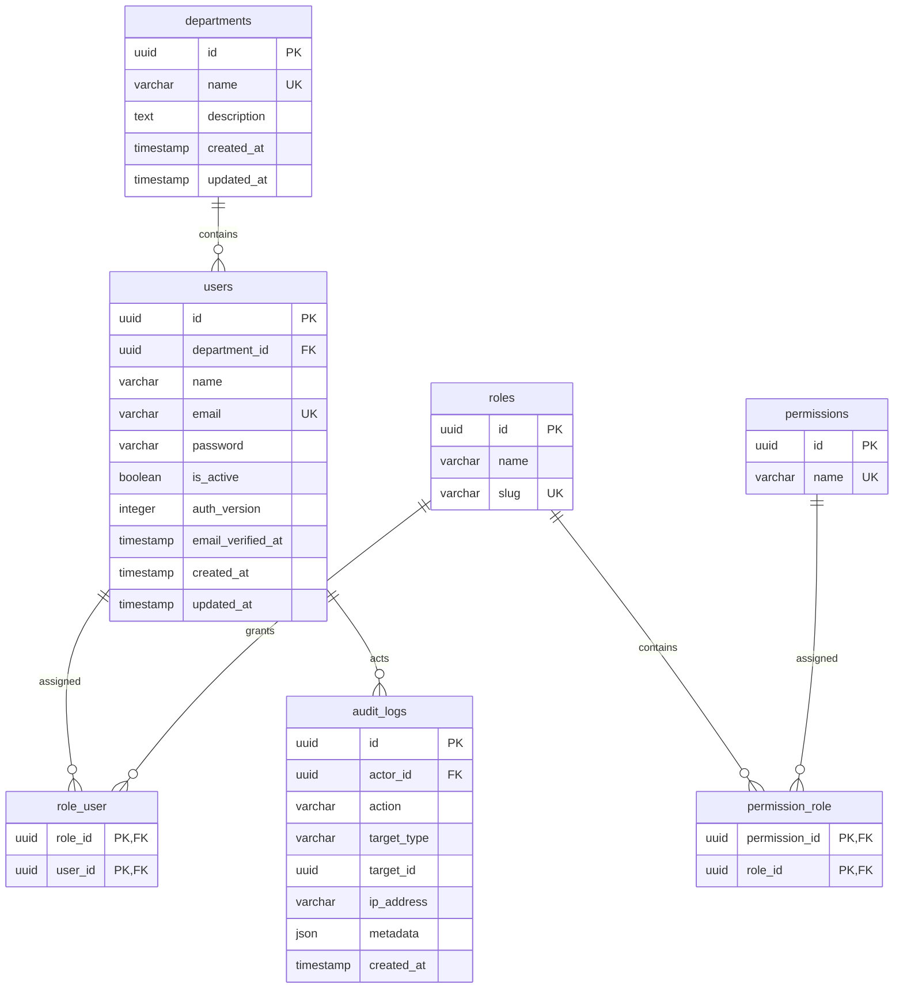
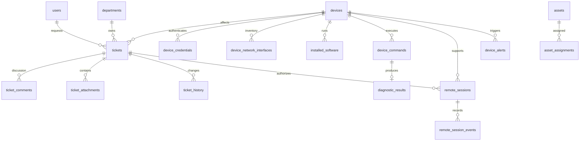

# Database design

Phase 2 adds the implemented ticket schema described in [the helpdesk contract](phase-2.md) and migration `2026_10_08_000003_create_helpdesk_tables.php`. PostgreSQL sessions are fixed to UTC for consistent timestamp storage and SLA comparisons.

Phase 3 adds `devices`, `device_credentials`, `enrollment_grants`, `agent_nonces`, `device_hardware`, `device_disks`, and `device_network_interfaces`; see [the signed-agent design](phase-3.md). Device UUIDs are independent from ticket requesters; reported ticket device names remain free text pending a future explicit ticket-device association.

## Phase 1 ERD

Users' email addresses are normalized to lowercase before validation and persistence. Unique indexes enforce identities. `department_id` is nullable and indexed. Join tables use composite primary keys and cascading foreign keys. Audit actor IDs are nullable for anonymous authentication events; actions, target IDs and creation time are indexed. Audit API is read-only and permission-restricted.

Laravel's password_reset_tokens stores an email key, hashed token and timestamp. Sessions are held in Redis with a configurable lifetime. Queue job, batch and failed-job tables follow Laravel conventions. No secrets belong in audit metadata.

## Later module schema, not Phase 1 migrations

- Tickets: UUID, unique display number, requester and technician FKs, department/device FKs, title, description, category, priority, status, resolution notes, SLA deadlines and timestamps. A year-keyed counter locked inside the creation transaction generates `INC-YYYY-NNNNNN`; never use `max + 1`.
- Comments: author FK, ticket FK, body, visibility (`public` or `internal`), timestamps. Employee queries exclude internal notes at the database/resource boundary.
- Attachments: private storage key, filename, size, detected media type, uploader, ticket/comment FK. Authenticated downloads and scanning before release; never executable public paths.
- Devices: stable UUID, assigned user, group, hostname, OS, agent version, enrollment/last_seen/revocation timestamps. Normalized disks, NICs, software and hardware tables. Current metrics separate from bounded history (7 days raw, 90 days aggregates).
- Credentials and enrollment grants: hashed, scoped, expiring/revocable, use count; enrollment tokens never become device bearer credentials.
- Commands: enum allow-list ID, versioned validated parameters, requester, device, ticket, expiry, lease, status and bounded result. Unique request IDs prevent replay.
- Remote sessions: device, employee, technician and ticket FKs; requested and approved modes, expiry and state timestamps, engine correlation ID. Append-only event records retain consent and transitions.
- Alerts: rule/device fingerprint unique while open; cooldown and recovery suppress duplicate incidents.
- Assets and assignments: inventory fields are normalized, historical assignment periods retained. Webhook deliveries reference event IDs and retain bounded retry metadata.

Apply foreign keys and indexes after reviewing the real access patterns in each phase. Soft deletion is reserved for records whose visibility needs to change while business history must remain.

Phase 4 adds `device_commands`, referencing devices, requesting users and optional tickets. It persists request idempotency keys, execution leases, lifecycle timestamps and JSONB measurements. Device/user/ticket deletion is restricted while referenced. See [diagnostic contracts](phase-4.md).

Phase 5 adds `alert_rules` (four versioned policies), `device_alerts` (audited condition episodes and incident links), `monitor_states` (distinct-sample qualification/deduplication), and `monitor_runs` (completed-sweep freshness). A partial unique index prevents multiple active alerts for one device/kind/resource. Tickets allow a null requester for internal monitoring incidents; recovery does not close tickets. See [monitoring design](phase-5.md).
